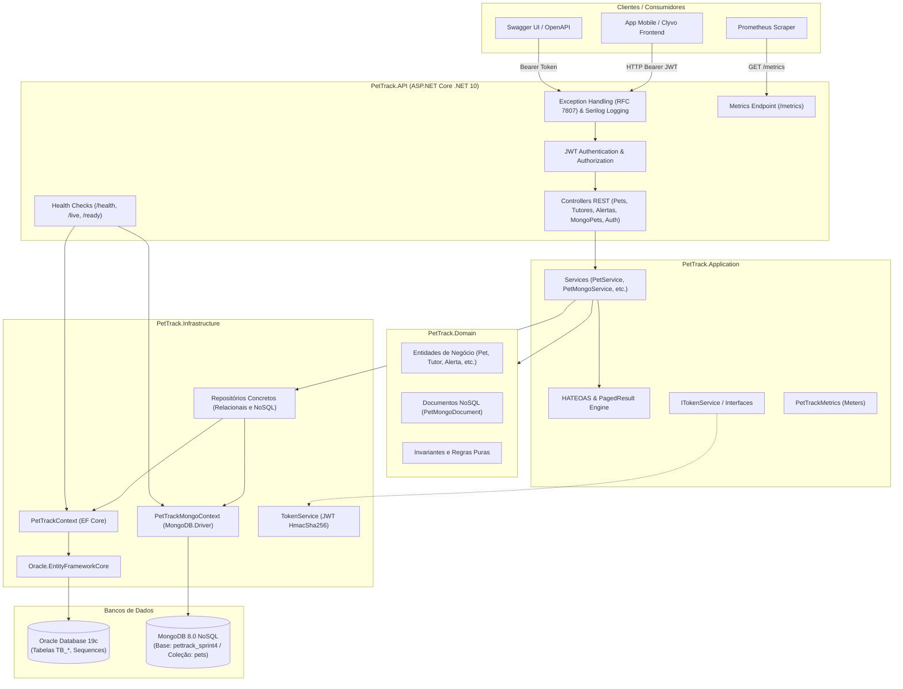

# 🐾 PetTrack API — ASP.NET Core & Clyvo Vet (Sprint 4 — Consolidação Final)

> **Sistema Operacional da Saúde Contínua do Pet** — Aplicação completa e consolidada em **ASP.NET Core (.NET 10)** seguindo **Clean Architecture**, equipada com **Persistência Híbrida (Oracle Relacional + MongoDB NoSQL)**, **Autenticação e Autorização JWT Bearer**, **HATEOAS**, **Paginação, Ordenação e Filtros Dinâmicos**, **Observabilidade Total (Serilog, Health Checks, OpenTelemetry / Prometheus)** e **Suíte de Testes Automatizados com Padrão AAA (127 testes: 96 Unitários + 31 de Integração, 100% de aprovação)** para o **Challenge FIAP 2026** em parceria com a **Clyvo Vet**.

---

## 👥 Integrantes da Equipe

| Nome Completo | RM | Turma |
|---|---|---|
| **Gabriel Sbrana Campos** | RM 565849 | 2TDSPF |
| **Moisés Waidemann** | RM 563719 | 2TDSPF |
| **Thiago Rodrigues da Mota** | RM 563650 | 2TDSPF |
| **Richard Freitas** | RM 566127 | 2TDSPF |

- **Instituição:** FIAP — Faculdade de Informática e Administração Paulista
- **Curso:** Análise e Desenvolvimento de Sistemas (2º Ano ADS - Turma 2TDSPF)
- **Disciplina:** Advanced Business Development with .NET
- **Parceiro de Negócio:** Clyvo Vet

---

## 📋 Sumário
1. [Visão Geral do Projeto](#-visão-geral-do-projeto)
2. [Arquitetura da Solução & Diagramas](#-arquitetura-da-solução--diagramas)
3. [Autenticação e Autorização JWT](#-autenticação-e-autorização-jwt)
4. [Paginação, Ordenação, Filtros e HATEOAS](#-paginação-ordenação-filtros-e-hateoas)
5. [Persistência Híbrida: Relacional (Oracle) & NoSQL (MongoDB)](#-persistência-híbrida-oracle--mongodb)
6. [Observabilidade e Monitoramento](#-observabilidade-e-monitoramento)
   - [Health Checks (`/health`, `/health/live`, `/health/ready`)](#1-health-checks)
   - [Structured Logging com Serilog](#2-structured-logging-com-serilog)
   - [Distributed Tracing & Métricas Prometheus via OpenTelemetry](#3-distributed-tracing--métricas-prometheus-via-opentelemetry)
7. [Testes Automatizados com Padrão AAA (127 Testes)](#-testes-automatizados-com-padrão-aaa)
   - [PetTrack.UnitTests (96 testes)](#1-testes-unitários-pettrackunittests)
   - [PetTrack.IntegrationTests (31 testes)](#2-testes-de-integração-pettrackintegrationtests)
   - [Como Executar os Testes](#3-como-executar-a-suíte-de-testes)
8. [Catálogo Completo de Endpoints REST & Swagger UI](#-catálogo-completo-de-endpoints-rest--swagger-ui)
9. [Instruções de Instalação e Execução](#-instruções-de-instalação-e-execução)
10. [Tecnologias e Pacotes Utilizados](#-tecnologias-e-pacotes-utilizados)

---

## 📌 Visão Geral do Projeto

O **PetTrack** é uma solução de ponta a ponta voltada ao acompanhamento contínuo da saúde preventiva de cães e gatos. Ele conecta tutores, clínicas veterinárias e dispositivos IoT de monitoramento em um ecossistema inteligente e seguro:
- **Gestão Cadastral Completa:** Tutores, pets e clínicas veterinárias interligados relacionalmente.
- **Histórico Clínico e Farmacológico:** Registro de prescrições, eventos clínicos e monitoramento rigoroso de adesão medicamentosa.
- **Telemetria Contínua IoT Clyvo:** Coleta contínua de temperatura, frequência cardíaca, atividade e localização emitida por colares inteligentes.
- **Detecção de Anomalias:** Motor de regras e emissão automática de alertas clínicos e notificações em tempo real.
- **Alta Disponibilidade e Performance com Persistência Híbrida:** 
  - Banco Relacional **Oracle Database** para consistência ACID e transações críticas;
  - Banco NoSQL **MongoDB** para consultas rápidas desnormalizadas e agregação de documentos de animais.

---

## 🏗️ Arquitetura da Solução & Diagramas

O projeto adota rigorosamente a **Clean Architecture** (Arquitetura Limpa), os princípios **SOLID** e **Domain-Driven Design (DDD)**:

```
PetTrack/
├── PetTrack.API/                  → Entrypoint HTTP, Controllers REST, Middleware JWT, Global Exception Handler, Swagger, Serilog, OpenTelemetry, Health Checks
├── PetTrack.Application/          → Casos de uso, DTOs (Requests/Responses), Interfaces de Repositórios/Serviços, Paginação, HATEOAS, Métricas
├── PetTrack.Domain/               → Entidades de Domínio, Invariantes de Negócio, Documentos NoSQL (PetMongoDocument), Enums
├── PetTrack.Infrastructure/       → DbContext EF Core, Mapeamentos Fluent API Oracle, MongoDB Context & Repositórios Concretos, TokenService JWT
├── PetTrack.UnitTests/            → Testes Unitários de Domínio, Serviços, JWT, Paginação, HATEOAS e NoSQL (xUnit + Moq + FluentAssertions)
└── PetTrack.IntegrationTests/     → Testes de Integração End-to-End da API HTTP (WebApplicationFactory + InMemory Database + Token Bearer)
```

### Diagrama da Arquitetura (Mermaid)



---

## 🔐 Autenticação e Autorização JWT

A API implementa autenticação baseada em **JSON Web Token (JWT Bearer)** com assinatura simétrica HMAC-SHA256 e controle de acesso baseado em perfis (**Role-Based Access Control - RBAC**):

### Perfis de Acesso Disponíveis:
- **`Admin`**: Acesso total a todas as operações de mutação (cadastro, edição, remoção e sincronização relacional/NoSQL).
- **`Veterinario`**: Acesso para criação de diagnósticos, consultas clínicas e atualização de status de saúde.
- **`Tutor`**: Acesso de visualização e registro de adesão a medicamentos do seu próprio pet.

### Credenciais Padrão Pré-configuradas para Testes/Avaliação:
| E-mail | Senha | Perfil (Role) |
|---|---|---|
| `admin@pettrack.com` | `admin123` | **Admin** |
| `vet@clyvovet.com` | `vet123` | **Veterinario** |
| `tutor@pettrack.com` | `tutor123` | **Tutor** |

### Fluxo de Autenticação:
1. Envie um `POST /api/auth/login` com email e senha.
2. A API valida as credenciais e devolve o token JWT com claims e tempo de expiração.
3. Nas rotas protegidas (`[Authorize]`), envie o cabeçalho HTTP:
   ```http
   Authorization: Bearer <seu_token_jwt>
   ```
4. No **Swagger UI**, clique no botão **Authorize 🔓** no topo da página e informe: `Bearer <seu_token_jwt>`.

---

## 📄 Paginação, Ordenação, Filtros e HATEOAS

A API atende integralmente ao nível de maturidade REST com hipermídia (**HATEOAS**) e suporte a consultas paginadas e ordenadas:

### 1. Endpoint Paginado: `GET /api/pets/paged`
Parâmetros aceitos na Query String:
- `pageNumber`: Número da página (padrão: `1`).
- `pageSize`: Quantidade de itens por página (padrão: `10`, máx: `50`).
- `sortBy`: Campo para ordenação (`Nome`, `Id`, `Idade`, `Peso`, `Especie`).
- `sortDirection`: Direção da ordenação (`asc` ou `desc`).
- `nome`, `especie`, `raca`, `sexo` (`M` ou `F`), `clinicaId`, `tutorId`: Filtros dinâmicos opcionais.

#### Exemplo de Resposta Paginada com Links HATEOAS:
```json
{
  "items": [
    {
      "id": 1,
      "nome": "Thor",
      "especie": "Canina",
      "raca": "Golden Retriever",
      "sexo": "M",
      "idade": 3.5,
      "peso": 28.5,
      "dataCadastro": "2026-05-22T21:41:50",
      "tutor": { "id": 1, "nome": "Moisés Waidemann" },
      "clinica": { "id": 1, "nome": "Clyvo Vet Care" },
      "links": [
        { "href": "/api/pets/1", "rel": "self", "method": "GET" },
        { "href": "/api/pets/1", "rel": "update", "method": "PUT" },
        { "href": "/api/pets/1", "rel": "delete", "method": "DELETE" },
        { "href": "/api/pets", "rel": "all", "method": "GET" },
        { "href": "/api/pets/paged", "rel": "paged", "method": "GET" }
      ]
    }
  ],
  "pageNumber": 1,
  "pageSize": 10,
  "totalItems": 15,
  "totalPages": 2,
  "hasPreviousPage": false,
  "hasNextPage": true,
  "links": [
    { "href": "/api/pets/paged?pageSize=10&sortBy=Nome&sortDirection=asc&pageNumber=1", "rel": "self", "method": "GET" },
    { "href": "/api/pets/paged?pageSize=10&sortBy=Nome&sortDirection=asc&pageNumber=1", "rel": "first", "method": "GET" },
    { "href": "/api/pets/paged?pageSize=10&sortBy=Nome&sortDirection=asc&pageNumber=2", "rel": "last", "method": "GET" },
    { "href": "/api/pets/paged?pageSize=10&sortBy=Nome&sortDirection=asc&pageNumber=2", "rel": "next", "method": "GET" },
    { "href": "/api/pets", "rel": "create", "method": "POST" }
  ]
}
```

---

## 🗄️ Persistência Híbrida: Oracle & MongoDB

A solução implementa arquitetura de persistência poliglota (**Polyglot Persistence**) com separação clara de responsabilidades via **Repository Pattern**:

### 1. Banco Relacional (Oracle Database)
- **Tecnologia:** Entity Framework Core (`Oracle.EntityFrameworkCore`).
- **Finalidade:** Modelagem relacional transacional ACID com 12 tabelas (`TB_PET`, `TB_TUTOR`, `TB_CLINICA`, `TB_ALERTA`, `TB_MEDICAMENTO`, `TB_ADESAO_MEDICAMENTO`, etc.), integridade referencial com chaves estrangeiras e sequências numéricas (`SEQ_*`).
- **Migrações:** Histórico de migrações EF Core localizado em `PetTrack.Infrastructure/Migrations/`.

### 2. Banco NoSQL (MongoDB)
- **Tecnologia:** Driver oficial .NET `MongoDB.Driver`.
- **Finalidade:** Base de documentos de alta performance para visualização desnormalizada e rápida dos animais com seus vínculos.
- **Configuração:**
  - **Conexão:** `mongodb://127.0.0.1:27017`
  - **Base de Dados:** `pettrack_sprint4`
  - **Coleção:** `pets`
- **Operações NoSQL Reais Suportadas:**
  - `GET /api/mongopets`: listagem de todos os documentos NoSQL com HATEOAS.
  - `GET /api/mongopets/{id}`: busca por ID primário do documento.
  - `GET /api/mongopets/tutor/{tutorId}`: consulta por tutor embutido.
  - `GET /api/mongopets/clinica/{clinicaId}`: consulta por clínica embutida.
  - `POST /api/mongopets`: inserção de documento NoSQL.
  - `PUT /api/mongopets/{id}`: atualização de documento NoSQL.
  - `DELETE /api/mongopets/{id}`: remoção de documento NoSQL.
  - `POST /api/mongopets/sync`: sincronização automática das entidades relacionais do Oracle para a base NoSQL do MongoDB pelo backend .NET.

---

## 🔭 Observabilidade e Monitoramento

### 1. Health Checks
A aplicação expõe 3 endpoints padronizados com resposta formatada em JSON detalhado (`UIResponseWriter.WriteHealthCheckUIResponse`):

- **`/health`**: Visão completa e consolidada de integridade de todos os subsistemas da API.
- **`/health/live`**: *Liveness Probe* do Kubernetes/Cloud para verificar se o processo da API está ativo e responsivo (`self`).
- **`/health/ready`**: *Readiness Probe* validando a conectividade com ambos os bancos de dados (**Oracle** e **MongoDB**) e com o serviço IoT:
  - `oracle_db`: Conexão com o banco relacional Oracle via EF Core;
  - `mongodb`: Conexão com a base NoSQL MongoDB (`pettrack_sprint4`) via ping ativo;
  - `clyvo_iot_service`: Conectividade do gateway de telemetria dos colares IoT.

### 2. Structured Logging com Serilog
A API realiza logging contextualizado e estruturado em dois sinks simultâneos:
1. **Console**: Colorido com enriquecimento de contexto (`FromLogContext`, timestamp, trace ID);
2. **Arquivo Rotativo Diário**: Gravado em `logs/pettrack-.log` com retenção automática de 7 dias.

### 3. Distributed Tracing & Métricas Prometheus via OpenTelemetry
Métricas de runtime, requisições HTTP e métricas de negócio expostas em:
- **`/metrics`**: Endpoint compatível com Prometheus contendo contadores customizados (`pettrack_pets_created_total`, `pettrack_tutores_created_total`, `pettrack_alertas_created_total`, etc.).

---

## 🧪 Testes Automatizados com Padrão AAA

A suíte possui **127 testes automatizados (100% de aprovação, 0 falhas)** organizados rigorosamente sob a convenção:
`MetodoTestado_Cenario_ResultadoEsperado` e divididos em **Arrange, Act e Assert**.

```
Aprovado! – Total: 127 testes (96 Unitários + 31 de Integração) – Falhas: 0
```

### 1. Testes Unitários (`PetTrack.UnitTests` — 96 testes)
- **Domínio (`Domain/`)**: Validação de invariantes, regras de negócio e lançamentos de exceções nas entidades `Pet`, `Tutor`, `Alerta`, `AdesaoMedicamento`, `Clinica`, `EventoClinico`, `Medicamento` e `CollarLeitura`.
- **Serviços (`Services/`)**: 
  - `PetServiceTests`, `TutorServiceTests`, `AlertaServiceTests`, `AdesaoMedicamentoServiceTests` com mocks Moq;
  - `TokenServiceTests`: geração de JWT, validação de credenciais, expiração e claims de roles;
  - `PetPaginationAndHateoasTests`: cálculo de total de páginas, normalização de limites de página e geração de links hipermídia;
  - `PetMongoServiceTests`: inserção, consulta, atualização, exclusão e sincronização NoSQL.

### 2. Testes de Integração (`PetTrack.IntegrationTests` — 31 testes)
- **`CustomWebApplicationFactory<Program>`**: Sobe o pipeline HTTP completo isolado em memória com `UseInMemoryDatabase` para o EF Core e `InMemoryPetMongoRepository` para o MongoDB (garantindo velocidade e sem onerar sessões do Oracle).
- **Validação de Fluxos e Contratos HTTP**:
  - `200 OK`: `GetAll`, `GetById`, `GetPaged`, `/health/live`, `/metrics`, `/api/auth/me` autenticado;
  - `201 Created`: Inserção de pets relacionais e NoSQL com cabeçalho `Location`;
  - `204 NoContent`: Remoção de pets relacionais e NoSQL autenticados;
  - `400 BadRequest`: Validações de payload e regras inválidas;
  - `401 Unauthorized`: Validação de bloqueio em endpoints protegidos (`POST /api/pets`, `DELETE /api/pets`, `POST /api/mongopets`, `GET /api/auth/me`) quando chamada sem token Bearer ou com credenciais incorretas;
  - `404 NotFound`: Busca e exclusão de IDs inexistentes.

### 3. Como Executar a Suíte de Testes

```bash
# Executar todos os testes da solução (Unitários e Integração)
dotnet test

# Executar apenas testes unitários
dotnet test PetTrack.UnitTests/PetTrack.UnitTests.csproj

# Executar apenas testes de integração
dotnet test PetTrack.IntegrationTests/PetTrack.IntegrationTests.csproj

# Executar com relatório verboso
dotnet test --logger "console;verbosity=detailed"
```

---

## 📡 Catálogo Completo de Endpoints REST & Swagger UI

Quando a API estiver em execução, o Swagger UI interativo com suporte a Bearer Token estará disponível em:
👉 **`http://localhost:5084/swagger`**

| Categoria | Método | Endpoint | Protegido? | Descrição |
|---|---|---|---|---|
| **Auth** | POST | `/api/auth/login` | Não | Realiza login e retorna token JWT |
| **Auth** | GET | `/api/auth/me` | **Sim (Bearer)** | Retorna dados e perfil do usuário logado |
| **Pets** | GET | `/api/pets` | Não | Lista todos os pets com links HATEOAS |
| **Pets** | GET | `/api/pets/paged` | Não | Consulta paginada com filtros e links HATEOAS |
| **Pets** | GET | `/api/pets/{id}` | Não | Busca pet por ID com links HATEOAS |
| **Pets** | GET | `/api/pets/clinica/{idClinica}` | Não | Lista pets por clínica |
| **Pets** | GET | `/api/pets/sexo?sexo=M` | Não | Filtra pets por sexo |
| **Pets** | GET | `/api/pets/buscar?busca=Rex` | Não | Busca por nome ou espécie |
| **Pets** | GET | `/api/pets/alertasPendentes` | Não | Lista pets com alertas não resolvidos |
| **Pets** | POST | `/api/pets` | **Sim (Bearer)** | Cadastra novo pet |
| **Pets** | PUT | `/api/pets/{id}` | **Sim (Bearer)** | Atualiza dados do pet |
| **Pets** | DELETE | `/api/pets/{id}` | **Sim (Bearer)** | Remove pet do cadastro |
| **MongoDB** | GET | `/api/mongopets` | Não | Lista documentos NoSQL com HATEOAS |
| **MongoDB** | GET | `/api/mongopets/{id}` | Não | Busca documento NoSQL por ID com HATEOAS |
| **MongoDB** | GET | `/api/mongopets/tutor/{tutorId}` | Não | Lista documentos NoSQL por tutor |
| **MongoDB** | GET | `/api/mongopets/clinica/{clinicaId}` | Não | Lista documentos NoSQL por clínica |
| **MongoDB** | POST | `/api/mongopets` | **Sim (Bearer)** | Insere documento NoSQL no MongoDB |
| **MongoDB** | PUT | `/api/mongopets/{id}` | **Sim (Bearer)** | Atualiza documento NoSQL no MongoDB |
| **MongoDB** | DELETE | `/api/mongopets/{id}` | **Sim (Bearer)** | Remove documento NoSQL do MongoDB |
| **MongoDB** | POST | `/api/mongopets/sync` | **Sim (Bearer)** | Sincroniza dados do Oracle para o MongoDB |
| **Tutores** | GET | `/api/tutores` | Não | Lista todos os tutores |
| **Tutores** | GET | `/api/tutores/{id}` | Não | Busca tutor por ID |
| **Tutores** | POST | `/api/tutores` | Não | Cadastra novo tutor |
| **Alertas** | GET | `/api/alertas` | Não | Lista alertas emitidos |
| **Alertas** | POST | `/api/alertas` | Não | Registra novo alerta |
| **Collar** | GET | `/api/collarleituras` | Não | Lista leituras de coleiras IoT |
| **Collar** | POST | `/api/collarleituras` | Não | Registra telemetria de coleira IoT |
| **Medicamentos** | GET | `/api/medicamentos` | Não | Lista medicamentos e prescrições |
| **Adesões** | GET | `/api/adesoemedicamento` | Não | Histórico de doses administradas |
| **Health** | GET | `/health` | Não | Status consolidado de saúde (API, Oracle, MongoDB, IoT) |
| **Health Live** | GET | `/health/live` | Não | Liveness probe do processo |
| **Health Ready** | GET | `/health/ready` | Não | Readiness probe dos bancos e integrações |
| **Métricas** | GET | `/metrics` | Não | Métricas Prometheus / OpenTelemetry |

---

## 🚀 Instruções de Instalação e Execução

### Pré-requisitos
- [.NET 10 SDK](https://dotnet.microsoft.com/download) instalado;
- Servidor MongoDB local em execução em `mongodb://127.0.0.1:27017`;
- Acesso à rede com o banco de dados Oracle FIAP (caso deseje executar contra o banco real).

### Passo a Passo

1. **Navegar até a pasta da solução:**
```bash
cd ADVANCED-BUSINESS-DEVELOPMENT-WITH-NET/PetTrack
```

2. **Garantir que o MongoDB local está em execução:**
```powershell
Get-NetTCPConnection -LocalPort 27017 -State Listen
```

3. **Restaurar os Pacotes NuGet:**
```bash
dotnet restore
```

4. **Compilar a Solução:**
```bash
dotnet build
```

5. **Executar a Suíte Completa de Testes:**
```bash
dotnet test
```

6. **Iniciar a API:**
```bash
dotnet run --project PetTrack.API/PetTrack.API.csproj
```

7. **Acessar a Aplicação:**
- **Swagger UI:** `http://localhost:5084/swagger`
- **Health Checks:** `http://localhost:5084/health`
- **Métricas Prometheus:** `http://localhost:5084/metrics`

---

## 📦 Tecnologias e Pacotes Utilizados

| Pacote / Tecnologia | Versão | Camada | Função no Projeto |
|---|---|---|---|
| **.NET SDK** | 10.0 | Geral | Runtime e SDK de desenvolvimento principal |
| **Microsoft.AspNetCore.Authentication.JwtBearer** | 10.0.14 | API | Middleware de autenticação JWT Bearer |
| **System.IdentityModel.Tokens.Jwt** | 8.23.0 | Infrastructure / API | Criação, assinatura e decodificação de tokens JWT |
| **MongoDB.Driver** | 3.13.0 | Infrastructure | Driver oficial de comunicação e operações NoSQL com MongoDB |
| **MongoDB.Bson** | 3.13.0 | Domain / Infrastructure | Serialização e mapeamento de documentos BSON |
| **Oracle.EntityFrameworkCore** | 9.23.60 | Infrastructure | Provedor EF Core oficial para banco Oracle |
| **Microsoft.EntityFrameworkCore** | 9.0.14 | Infrastructure | ORM para mapeamento objeto-relacional |
| **Serilog.AspNetCore** | 9.0.0 | API | Structured Logging para console e arquivos rotativos diários |
| **AspNetCore.HealthChecks.UI.Client** | 9.0.0 | API | Serialização JSON rica para os endpoints de Health Check |
| **OpenTelemetry.Extensions.Hosting** | 1.12.0 | API | Framework de observabilidade e tracing distribuído |
| **OpenTelemetry.Exporter.Prometheus.AspNetCore** | 1.12.0-beta.1 | API | Exportação de métricas no padrão Prometheus (`/metrics`) |
| **xUnit** | 2.9.2 | Testes | Framework de testes unitários e de integração com padrão AAA |
| **Moq** | 4.20.72 | Testes | Mocking de dependências e isolamento de camadas |
| **FluentAssertions** | 6.12.2 | Testes | Assertions expressivas e legíveis |
| **Microsoft.AspNetCore.Mvc.Testing** | 9.0.0 | Testes | WebApplicationFactory para testes de integração HTTP |
| **Microsoft.EntityFrameworkCore.InMemory** | 9.0.0 | Testes | Banco em memória para isolamento de testes sem onerar o Oracle |
| **Swashbuckle.AspNetCore** | 7.2.0 | API | Documentação interativa OpenAPI / Swagger UI com Bearer Auth |

---

> Projeto desenvolvido para o **Challenge FIAP 2026** — 2º Ano Análise e Desenvolvimento de Sistemas (Turma 2TDSPF).
