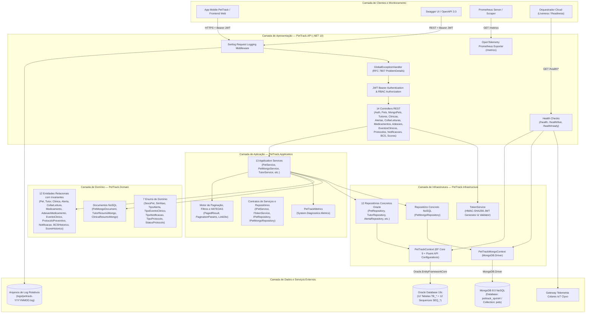
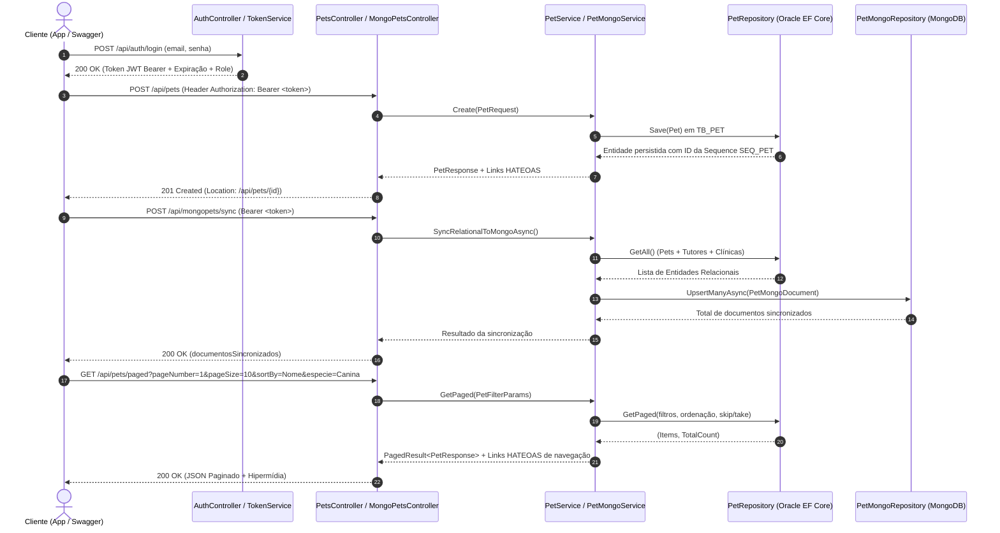

# 🐾 PetTrack API — ASP.NET Core & Clyvo Vet (Sprint 4 — Entrega Final)

> **Sistema Operacional da Saúde Contínua do Pet** — API RESTful completa e consolidada desenvolvida em **ASP.NET Core (.NET 10)** seguindo **Clean Architecture**, princípios **SOLID** e **Clean Code**, equipada com **Persistência Híbrida Poliglota (Oracle Database Relacional via EF Core + MongoDB NoSQL)**, **Autenticação e Autorização JWT Bearer (RBAC)**, **HATEOAS**, **Paginação, Ordenação e Filtros Dinâmicos**, **Tratamento Global de Exceções (RFC 7807 ProblemDetails)**, **Observabilidade Completa (Serilog, Health Checks, OpenTelemetry / Prometheus)** e **Suíte de Testes Automatizados no Padrão AAA (127 testes: 96 Unitários + 31 de Integração, 100% de aprovação)** para o **Challenge FIAP 2026** em parceria com a **Clyvo Vet**.

---

## 👥 Integrantes da Equipe

| Nome Completo | RM | Turma |
|---|---|---|
| **Gabriel Sbrana Campos** | RM 565849 | 2TDSPF |
| **Moisés Waidemann** | RM 563719 | 2TDSPF |
| **Thiago Rodrigues da Mota** | RM 563650 | 2TDSPF |
| **Richard Freitas** | RM 566127 | 2TDSPF |

- **Instituição:** FIAP — Faculdade de Informática e Administração Paulista
- **Curso:** Análise e Desenvolvimento de Sistemas (2º Ano ADS — Turma 2TDSPF)
- **Disciplina:** Advanced Business Development with .NET
- **Parceiro de Negócio:** Clyvo Vet

---

## 📋 Sumário

1. [Visão Geral do Projeto e Evolução das Sprints](#-1-visão-geral-do-projeto-e-evolução-das-sprints)
2. [Arquitetura e Qualidade de Código (Clean Architecture, SOLID, DI e Exception Handling)](#-2-arquitetura-e-qualidade-de-código)
   - [Estrutura de Camadas e Regra de Dependência](#21-estrutura-de-camadas-e-regra-de-dependência)
   - [Diagrama de Arquitetura da Solução](#22-diagrama-de-arquitetura-da-solução)
   - [Diagrama de Fluxo de Requisição, Autenticação e Persistência Híbrida](#23-diagrama-de-fluxo-de-requisição-autenticação-e-persistência-híbrida)
   - [Princípios SOLID e Clean Code Aplicados](#24-princípios-solid-e-clean-code-aplicados)
   - [Injeção de Dependência (DI)](#25-injeção-de-dependência-di)
   - [Tratamento Global de Exceções (RFC 7807 ProblemDetails)](#26-tratamento-global-de-exceções-rfc-7807-problemdetails)
3. [API RESTful Completa (JWT, Paginação, Ordenação, Filtros, HATEOAS e Swagger)](#-3-api-restful-completa)
   - [Autenticação e Autorização com JWT Bearer (RBAC)](#31-autenticação-e-autorização-com-jwt-bearer-rbac)
   - [Paginação, Ordenação, Filtros Dinâmicos e HATEOAS](#32-paginação-ordenação-filtros-dinâmicos-e-hateoas)
   - [Documentação OpenAPI / Swagger Exportada](#33-documentação-openapi--swagger-exportada)
   - [Catálogo Completo de Endpoints da API (14 Controllers)](#34-catálogo-completo-de-endpoints-da-api-14-controllers)
4. [Persistência de Dados Relacional (Oracle EF Core) e NoSQL (MongoDB)](#-4-persistência-de-dados-relacional-e-nosql)
   - [Banco de Dados Relacional — Oracle Database & EF Core Migrations](#41-banco-de-dados-relacional--oracle-database--ef-core-migrations)
   - [Banco de Dados NoSQL — MongoDB & Sincronização Poliglota](#42-banco-de-dados-nosql--mongodb--sincronização-poliglota)
   - [Padrão Repository — Repositórios Concretos Implementados](#43-padrão-repository--repositórios-concretos-implementados)
5. [Monitoramento, Observabilidade e Testes Automatizados (Padrão AAA)](#-5-monitoramento-observabilidade-e-testes-automatizados)
   - [Health Checks (`/health`, `/health/live`, `/health/ready`)](#51-health-checks-health-healthlive-healthready)
   - [Logging Estruturado com Serilog](#52-logging-estruturado-com-serilog)
   - [Distributed Tracing e Métricas Prometheus via OpenTelemetry (`/metrics`)](#53-distributed-tracing-e-métricas-prometheus-via-opentelemetry-metrics)
   - [Testes Automatizados com Padrão AAA — xUnit, Moq e WebApplicationFactory (127 Testes)](#54-testes-automatizados-com-padrão-aaa--xunit-moq-e-webapplicationfactory-127-testes)
6. [Instruções de Instalação, Configuração e Execução](#-6-instruções-de-instalação-configuração-e-execução)
7. [Tecnologias e Pacotes Utilizados](#-7-tecnologias-e-pacotes-utilizados)

---

## 📌 1. Visão Geral do Projeto e Evolução das Sprints

O **PetTrack** é uma plataforma backend corporativa voltada ao acompanhamento contínuo da saúde preventiva de cães e gatos, desenvolvida para responder ao desafio proposto pela **Clyvo Vet**. O sistema conecta tutores, médicos veterinários, clínicas parceiras e dispositivos vestíveis (coleiras inteligentes IoT) em uma arquitetura unificada:

- **Problema Resolvido:** O atendimento veterinário tradicional é majoritariamente reativo — o tutor procura a clínica apenas quando os sintomas já estão avançados, e o acompanhamento pós-consulta sofre com falhas na administração de medicamentos, esquecimento de protocolos preventivos (vacinas, vermífugos, antiparasitários) e ausência de dados fisiológicos contínuos entre consultas.
- **Benefícios para o Negócio (Clyvo Vet, Clínicas e Tutores):**
  - **Monitoramento Contínuo de Sinais Vitais:** Recepção e análise de leituras telemétricas de colares IoT (temperatura corporal, frequência cardíaca, nível de atividade e geolocalização GPS).
  - **Gestão Clínica e Farmacológica Integrada:** Registro de eventos clínicos, prescrições de medicamentos, controle de adesão terapêutica dose a dose, histórico de escore de condição corporal (BCS 1–9) e escore geral de saúde (0–100).
  - **Prevenção Ativa e Engajamento:** Geração automatizada de alertas clínicos e envio de notificações urgentes aos tutores quando desvios fisiológicos ou atrasos preventivos são detectados.
  - **Persistência Poliglota de Alta Performance:** Transações relacionais íntegras no **Oracle Database** combinadas com leituras desnormalizadas ultrarrápidas no **MongoDB NoSQL**.

### Consolidação Evolutiva (Sprints 1 a 4)

| Sprint | Foco da Entrega | Funcionalidades Consolidadas no Projeto |
|---|---|---|
| **Sprint 1** | Modelagem de Domínio e Arquitetura | Definição das 12 entidades de negócio, invariantes de domínio ricas, enums, estrutura em camadas **Clean Architecture** e prototipação inicial dos endpoints REST. |
| **Sprint 2** | Persistência Relacional e API REST | Integração com **Oracle Database** via **Entity Framework Core**, mapeamentos Fluent API (`IEntityTypeConfiguration`), sequências Oracle (`SEQ_*`), migrações aplicadas, padrão Repository/Service e 12 Controllers CRUD completos com consultas customizadas. |
| **Sprint 3** | Observabilidade, Monitoramento e Testes AAA | Implementação de **Health Checks** (`/health`, `/health/live`, `/health/ready`), **Logging Estruturado** com **Serilog** (Console + Arquivo rotativo), **Tracing Distribuído e Métricas Prometheus** com **OpenTelemetry** (`/metrics`), e projetos separados de **Testes Unitários** e **Testes de Integração** com padrão **AAA**. |
| **Sprint 4** | Consolidação Final, Segurança JWT, NoSQL e Hipermídia | Autenticação e Autorização **JWT Bearer** com **RBAC** (`AuthController` + `TokenService`), **Persistência Híbrida com MongoDB NoSQL** (`MongoPetsController`, `PetMongoRepository`, sincronização Oracle → MongoDB), **Paginação, Ordenação e Filtros Dinâmicos** (`GET /api/pets/paged`), **HATEOAS** nos endpoints de consulta, expansão da suíte para **127 testes automatizados** e documentação OpenAPI final exportada ([`swagger.json`](swagger.json)). |

---

## 🏗️ 2. Arquitetura e Qualidade de Código

### 2.1 Estrutura de Camadas e Regra de Dependência

A solução foi arquitetada seguindo estritamente os padrões de **Clean Architecture** (Arquitetura Limpa) e **Domain-Driven Design (DDD)**, dividindo responsabilidades em 4 projetos principais de produção e 2 projetos de testes automatizados:

```text
ADVANCED-BUSINESS-DEVELOPMENT-WITH-NET/
├── README.md                          → Documentação completa e consolidada do projeto
├── pettrack.drawio                    → Diagrama arquitetural e relacional editável (Draw.io)
├── swagger.json                       → Especificação OpenAPI 3.0 exportada da API
└── PetTrack/
    ├── PetTrack.sln                   → Solution .NET 10 unificada
    ├── PetTrack.Domain/               → Camada de Domínio (Entidades ricas, Invariantes, PetMongoDocument, Enums)
    ├── PetTrack.Application/          → Camada de Aplicação (Services, Interfaces, DTOs, Paginação, HATEOAS, Métricas)
    ├── PetTrack.Infrastructure/       → Camada de Infraestrutura (EF Core Oracle, Migrations, MongoDB Driver, Repositories, JWT TokenService)
    ├── PetTrack.API/                  → Camada de Apresentação (Controllers REST, Auth JWT, GlobalExceptionHandler, HealthChecks, Serilog, OpenTelemetry)
    ├── PetTrack.UnitTests/            → Testes Unitários de Domínio e Aplicação (xUnit, Moq, FluentAssertions, Fixtures)
    └── PetTrack.IntegrationTests/     → Testes de Integração HTTP End-to-End (WebApplicationFactory, InMemory EF Core + InMemory Mongo)
```

#### Regra de Dependência entre Projetos
As dependências apontam exclusivamente para o centro (Domínio). `PetTrack.Domain` não depende de nenhum framework externo de banco relacional ou web:

```text
[PetTrack.API] ──────────► [PetTrack.Application] ──────────► [PetTrack.Domain]
      │                              ▲                               ▲
      ▼                              │                               │
[PetTrack.Infrastructure] ───────────┴───────────────────────────────┘
```

---

### 2.2 Diagrama de Arquitetura da Solução

> O arquivo original de modelagem também está disponível na raiz do repositório em [`pettrack.drawio`](pettrack.drawio).



---

### 2.3 Diagrama de Fluxo de Requisição, Autenticação e Persistência Híbrida



---

### 2.4 Princípios SOLID e Clean Code Aplicados

| Princípio | Aplicação Concreta no Código do PetTrack |
|---|---|
| **S — Single Responsibility Principle (SRP)** | Cada camada e classe possui uma única razão para mudar: Entidades em `PetTrack.Domain/Entities/` validam exclusivamente regras de negócio e invariantes; Serviços em `PetTrack.Application/Interfaces/Services/` orquestram casos de uso e mapeamento DTO; Repositórios em `PetTrack.Infrastructure/Persistence/Repositories/` isolam consultas EF Core e MongoDB; `GlobalExceptionHandler` trata exclusivamente erros HTTP; `TokenService` cuida apenas da emissão/validação de JWT. |
| **O — Open/Closed Principle (OCP)** | O pipeline de Health Checks (`IHealthCheck`), o tratamento de exceções (`IExceptionHandler`) e os filtros de consulta (`PetFilterParams`) são extensíveis para novos verificadores e critérios sem modificar a estrutura base dos consumidores. |
| **L — Liskov Substitution Principle (LSP)** | Qualquer implementação das interfaces de repositório (`IPetRepository`, `IPetMongoRepository`, `ITutorRepository`, etc.) pode substituir a implementação concreta sem quebrar o comportamento dos serviços — demonstrado na prática pela substituição transparente de `PetMongoRepository` por `InMemoryPetMongoRepository` e do Oracle por `InMemoryDatabase` nos testes de integração. |
| **I — Interface Segregation Principle (ISP)** | Interfaces segregadas e coesas por agregado de domínio (`IPetService`, `ITutorService`, `IAlertaService`, `ITokenService`, `IPetMongoRepository`), evitando interfaces monolíticas genéricas que forcem classes a depender de métodos que não utilizam. |
| **D — Dependency Inversion Principle (DIP)** | Os Controllers (`PetTrack.API`) dependem apenas de abstrações (`IPetService`, `IPetMongoService`, `ITokenService`), e os Application Services dependem apenas das interfaces de repositório (`IPetRepository`, `IPetMongoRepository`), nunca das classes concretas de infraestrutura. |
| **Clean Code & Fail-Fast Domain Validation** | Construtores ricos e métodos de domínio (`AtualizarDados`, `MarcarResolvido`, `RegistrarConfirmacao`) aplicam validações *Fail-Fast* lançando exceções semânticas imediatas quando dados inválidos são fornecidos, evitando estados inconsistentes (Anemic Domain Model). |

---

### 2.5 Injeção de Dependência (DI)

Toda a composição de dependências está centralizada em `PetTrack.API/Program.cs` utilizando o container nativo do ASP.NET Core com ciclos de vida adequados:

- **`AddScoped`**:
  - **12 Repositórios Relacionais Oracle:** `ITutorRepository`, `IClinicaRepository`, `IPetRepository`, `IAdesaoMedicamentoRepository`, `IAlertaRepository`, `IBCSHistoricoRepository`, `ICollarLeituraRepository`, `IEventoClinicoRepository`, `IMedicamentoRepository`, `INotificacaoRepository`, `IProtocoloPreventivoRepository`, `IScoreHistoricoRepository`.
  - **1 Repositório NoSQL MongoDB:** `IPetMongoRepository` → `PetMongoRepository`.
  - **13 Serviços de Aplicação:** `ITutorService`, `IClinicaService`, `IPetService`, `IPetMongoService`, `IAdesaoMedicamentoService`, `IAlertaService`, `IBcsHistoricoService`, `ICollarLeituraService`, `IEventoClinicoService`, `IMedicamentoService`, `INotificacaoService`, `IProtocoloPreventivoService`, `IScoreHistoricoService`.
  - **Serviço de Segurança:** `ITokenService` → `TokenService`.
  - **Contexto Relacional:** `PetTrackContext` (EF Core scoped por requisição HTTP).
- **`AddSingleton`**:
  - **Contexto NoSQL:** `PetTrackMongoContext` (gerencia o pool thread-safe de conexões do `IMongoClient` recomendado pelo driver oficial do MongoDB).

---

### 2.6 Tratamento Global de Exceções (RFC 7807 ProblemDetails)

A API implementa a interface `IExceptionHandler` do ASP.NET Core através da classe `GlobalExceptionHandler` (`PetTrack.API/Exceptions/GlobalExceptionHandler.cs`), interceptando qualquer exceção não tratada em qualquer camada, registrando o erro de forma estruturada no **Serilog** e retornando uma resposta padronizada no formato **RFC 7807 (`application/problem+json`)**:

| Exceção Capturada | Status HTTP | Título Retornado | Cenário de Ocorrência |
|---|---|---|---|
| `ArgumentNullException` | `400 Bad Request` | `Requisicao invalida` | Parâmetro obrigatório nulo nas entidades ou serviços |
| `ArgumentException` | `400 Bad Request` | `Requisicao invalida` | Violação de invariantes de domínio (ex.: peso negativo, CPF/CNPJ inválido, BCS fora de 1–9) |
| `InvalidOperationException` | `400 Bad Request` | `Nao foi possivel concluir a operacao` | Violação de regra de transição de estado de negócio |
| `KeyNotFoundException` | `404 Not Found` | `Recurso nao encontrado` | Tentativa de atualizar ou vincular registro com ID inexistente |
| `UnauthorizedAccessException` | `401 Unauthorized` | `Nao autorizado` | Falha de permissão ou credencial inválida |
| `OracleException` | `502 Bad Gateway` | `Banco de dados indisponivel` | Falha de comunicação ou constraint no servidor Oracle |
| `Exception` (Demais) | `500 Internal Server Error` | `Erro interno do servidor` | Falhas inesperadas protegidas sem vazar stack trace em produção |

#### Exemplo de Resposta de Erro Padronizada (`application/problem+json`):
```json
{
  "type": "about:blank",
  "title": "Requisicao invalida",
  "status": 400,
  "detail": "O nome do pet é obrigatório.",
  "instance": "/api/pets"
}
```

---

## 🌐 3. API RESTful Completa

### 3.1 Autenticação e Autorização com JWT Bearer (RBAC)

A segurança da API é implementada com **JSON Web Token (JWT Bearer)** assinado via algoritmo simétrico **HMAC-SHA256** (`Microsoft.AspNetCore.Authentication.JwtBearer`), validando emissor (`Issuer`), audiência (`Audience`), chave de assinatura (`IssuerSigningKey`) e expiração sem tolerância de atraso (`ClockSkew = TimeSpan.Zero`).

#### Perfis de Acesso (Roles):
- **`Admin`**: Acesso administrativo completo para criação, atualização, exclusão e sincronização entre Oracle e MongoDB.
- **`Veterinario`**: Perfil voltado ao corpo clínico parceiro da Clyvo Vet.
- **`Tutor`**: Perfil voltado aos responsáveis pelos animais.

#### Credenciais Pré-configuradas para Testes e Avaliação:

| E-mail | Senha | Perfil (`Role`) | Nome |
|---|---|---|---|
| `admin@pettrack.com` | `admin123` | `Admin` | Administrador PetTrack |
| `vet@clyvovet.com` | `vet123` | `Veterinario` | Dra. Helena Clyvo Vet |
| `tutor@pettrack.com` | `tutor123` | `Tutor` | Moisés Waidemann |

#### Como Autenticar (`POST /api/auth/login`):

**Request:**
```json
{
  "email": "admin@pettrack.com",
  "senha": "admin123"
}
```

**Response (`200 OK`):**
```json
{
  "token": "eyJhbGciOiJIUzI1NiIsInR5cCI6IkpXVCJ9...",
  "expiration": "2026-11-04T03:30:00Z",
  "email": "admin@pettrack.com",
  "nome": "Administrador PetTrack",
  "role": "Admin"
}
```

Para consumir endpoints protegidos (`[Authorize]`), envie o cabeçalho HTTP:
```http
Authorization: Bearer <seu_token_jwt>
```
No **Swagger UI**, basta clicar no botão **Authorize 🔓** no canto superior direito e informar `Bearer <seu_token_jwt>`.

---

### 3.2 Paginação, Ordenação, Filtros Dinâmicos e HATEOAS

O endpoint `GET /api/pets/paged` implementa paginação em nível de banco de dados (`Skip` / `Take`), ordenação ascendente/descendente multi-campo e filtros combináveis, retornando metadados de paginação e links de navegação **HATEOAS** tanto em nível de recurso individual quanto em nível de coleção paginada.

#### Parâmetros de Query String (`PetFilterParams` + `PaginationParams`):
- **`pageNumber`**: Número da página (padrão: `1`, mínimo: `1`).
- **`pageSize`**: Quantidade de registros por página (padrão: `10`, máximo: `50`).
- **`sortBy`**: Campo de ordenação (`Nome`, `Id`, `Idade`, `Peso`, `Especie`).
- **`sortDirection`**: Direção da ordenação (`asc` ou `desc`).
- **`nome`**: Filtro parcial por nome do pet (case-insensitive).
- **`especie`**: Filtro parcial por espécie (ex.: `Canina`, `Felina`).
- **`raca`**: Filtro parcial por raça (ex.: `Golden`, `Poodle`).
- **`sexo`**: Filtro exato por sexo (`M` ou `F`).
- **`clinicaId`**: Filtro exato por ID da clínica veterinária.
- **`tutorId`**: Filtro exato por ID do tutor responsável.

#### Exemplo de Resposta de `GET /api/pets/paged?pageNumber=1&pageSize=10&sortBy=Nome&sortDirection=asc`:
```json
{
  "items": [
    {
      "id": 1,
      "nome": "Thor",
      "especie": "Canina",
      "raca": "Golden Retriever",
      "sexo": "M",
      "idade": 3.5,
      "peso": 28.5,
      "dataCadastro": "2026-05-22T21:41:50",
      "tutor": {
        "id": 1,
        "nome": "Moisés Waidemann",
        "telefone": "11999999999",
        "email": "moises@email.com",
        "cidade": "São Paulo",
        "estado": "SP"
      },
      "clinica": {
        "id": 1,
        "nome": "Clyvo Vet Care",
        "cnpj": "12345678000199",
        "telefone": "1133334444",
        "cidade": "São Paulo",
        "estado": "SP"
      },
      "links": [
        { "href": "/api/pets/1", "rel": "self", "method": "GET" },
        { "href": "/api/pets/1", "rel": "update", "method": "PUT" },
        { "href": "/api/pets/1", "rel": "delete", "method": "DELETE" },
        { "href": "/api/pets", "rel": "all", "method": "GET" },
        { "href": "/api/pets/paged", "rel": "paged", "method": "GET" }
      ]
    }
  ],
  "pageNumber": 1,
  "pageSize": 10,
  "totalItems": 15,
  "totalPages": 2,
  "hasPreviousPage": false,
  "hasNextPage": true,
  "links": [
    { "href": "/api/pets/paged?pageSize=10&sortBy=Nome&sortDirection=asc&pageNumber=1", "rel": "self", "method": "GET" },
    { "href": "/api/pets/paged?pageSize=10&sortBy=Nome&sortDirection=asc&pageNumber=1", "rel": "first", "method": "GET" },
    { "href": "/api/pets/paged?pageSize=10&sortBy=Nome&sortDirection=asc&pageNumber=2", "rel": "last", "method": "GET" },
    { "href": "/api/pets/paged?pageSize=10&sortBy=Nome&sortDirection=asc&pageNumber=2", "rel": "next", "method": "GET" },
    { "href": "/api/pets", "rel": "create", "method": "POST" }
  ]
}
```

Os endpoints de `GET /api/pets`, `GET /api/pets/{id}`, `GET /api/mongopets`, `GET /api/mongopets/{id}`, `GET /api/mongopets/tutor/{tutorId}` e `GET /api/mongopets/clinica/{clinicaId}` também enriquecem automaticamente cada item retornado com seus respectivos links **HATEOAS** (`self`, `update`, `delete`, `all`, `sync-from-oracle`).

---

### 3.3 Documentação OpenAPI / Swagger Exportada

A documentação dos endpoints está disponível de duas formas complementares:
1. **Swagger UI Interativo (em execução):** `http://localhost:5084/swagger` (e JSON em `http://localhost:5084/swagger/v1/swagger.json`).
2. **Arquivo OpenAPI 3.0 Exportado no Repositório:** [`swagger.json`](swagger.json) localizado na raiz do projeto, contendo todos os schemas de Request/Response, descrições XML dos métodos e definições de segurança Bearer JWT.

---

### 3.4 Catálogo Completo de Endpoints da API (14 Controllers)

Abaixo estão documentados **todos os 94 endpoints** expostos pelos 14 Controllers REST e pelos middlewares de observabilidade da aplicação:

#### 🔐 1. Autenticação (`AuthController` — `/api/auth`)
| Método | Endpoint | Autenticação | Descrição |
|---|---|---|---|
| `POST` | `/api/auth/login` | Público | Autentica o usuário e retorna o token JWT Bearer, perfil e data de expiração |
| `GET` | `/api/auth/me` | **Bearer JWT** | Retorna os dados e claims do usuário autenticado a partir do token |

#### 🐶 2. Pets — Persistência Relacional Oracle (`PetsController` — `/api/pets`)
| Método | Endpoint | Autenticação | Descrição |
|---|---|---|---|
| `GET` | `/api/pets` | Público | Lista todos os pets com links HATEOAS |
| `GET` | `/api/pets/paged` | Público | Consulta paginada com ordenação dinâmica, filtros e links HATEOAS |
| `GET` | `/api/pets/{id}` | Público | Retorna um pet pelo ID com links HATEOAS |
| `GET` | `/api/pets/clinica/{idClinica}` | Público | Lista pets vinculados a uma clínica veterinária |
| `GET` | `/api/pets/sexo?sexo={M\|F}` | Público | Filtra pets pelo sexo (`M` ou `F`) |
| `GET` | `/api/pets/buscar?busca={termo}` | Público | Busca pets por nome ou espécie |
| `GET` | `/api/pets/alertasPendentes` | Público | Lista pets que possuem alertas clínicos pendentes |
| `POST` | `/api/pets` | **Bearer JWT** | Cadastra um novo pet no banco relacional |
| `PUT` | `/api/pets/{id}` | **Bearer JWT** | Atualiza os dados cadastrais de um pet |
| `DELETE` | `/api/pets/{id}` | **Bearer JWT** | Remove um pet pelo ID |

#### 🍃 3. MongoPets — Persistência NoSQL MongoDB (`MongoPetsController` — `/api/mongopets`)
| Método | Endpoint | Autenticação | Descrição |
|---|---|---|---|
| `GET` | `/api/mongopets` | Público | Lista todos os documentos de pets no MongoDB com links HATEOAS |
| `GET` | `/api/mongopets/{id}` | Público | Busca um documento de pet no MongoDB pelo ID com links HATEOAS |
| `GET` | `/api/mongopets/tutor/{tutorId}` | Público | Lista documentos de pets no MongoDB filtrados pelo ID do tutor embutido |
| `GET` | `/api/mongopets/clinica/{clinicaId}` | Público | Lista documentos de pets no MongoDB filtrados pelo ID da clínica embutida |
| `POST` | `/api/mongopets` | **Bearer JWT** | Insere um novo documento desnormalizado na coleção `pets` do MongoDB |
| `PUT` | `/api/mongopets/{id}` | **Bearer JWT** | Atualiza um documento existente no MongoDB |
| `DELETE` | `/api/mongopets/{id}` | **Bearer JWT** | Remove um documento da coleção do MongoDB |
| `POST` | `/api/mongopets/sync` | **Bearer JWT** | Sincroniza os registros relacionais do Oracle para documentos NoSQL no MongoDB |

#### 👤 4. Tutores (`TutoresController` — `/api/tutores`)
| Método | Endpoint | Autenticação | Descrição |
|---|---|---|---|
| `GET` | `/api/tutores` | Público | Lista todos os tutores cadastrados |
| `GET` | `/api/tutores/{id}` | Público | Busca um tutor pelo identificador |
| `GET` | `/api/tutores/buscar?busca={termo}` | Público | Busca tutores por nome ou e-mail |
| `GET` | `/api/tutores/nomePet?nomePet={nome}` | Público | Busca tutores a partir do nome de um pet vinculado |
| `POST` | `/api/tutores` | Público | Cadastra um novo tutor |
| `PUT` | `/api/tutores/{id}` | Público | Atualiza os dados de um tutor existente |
| `DELETE` | `/api/tutores/{id}` | Público | Remove um tutor pelo identificador |

#### 🏥 5. Clínicas Veterinárias (`ClinicasController` — `/api/clinicas`)
| Método | Endpoint | Autenticação | Descrição |
|---|---|---|---|
| `GET` | `/api/clinicas` | Público | Lista todas as clínicas veterinárias parceiras |
| `GET` | `/api/clinicas/{id}` | Público | Busca uma clínica pelo identificador |
| `GET` | `/api/clinicas/buscar?busca={termo}` | Público | Busca clínicas por razão/nome ou CNPJ |
| `GET` | `/api/clinicas/nomePet?nomePet={nome}` | Público | Retorna clínicas associadas ao nome de um pet |
| `POST` | `/api/clinicas` | Público | Cadastra uma nova clínica veterinária |
| `PUT` | `/api/clinicas/{id}` | Público | Atualiza os dados de uma clínica |
| `DELETE` | `/api/clinicas/{id}` | Público | Remove uma clínica pelo identificador |

#### 🚨 6. Alertas Clínicos e Preventivos (`AlertasController` — `/api/alertas`)
| Método | Endpoint | Autenticação | Descrição |
|---|---|---|---|
| `GET` | `/api/alertas` | Público | Lista todos os alertas gerados |
| `GET` | `/api/alertas/{id}` | Público | Busca um alerta pelo identificador |
| `GET` | `/api/alertas/tipo?tipo={TipoAlertaEnum}` | Público | Filtra alertas por tipo (`FEBRE`, `ATIVIDADE_BAIXA`, `MEDICAMENTO`, etc.) |
| `GET` | `/api/alertas/pendentes/{idPet}` | Público | Lista alertas pendentes (não resolvidos) de um pet específico |
| `POST` | `/api/alertas` | Público | Registra um novo alerta |
| `PUT` | `/api/alertas/{id}` | Público | Atualiza os dados ou resolução de um alerta |
| `DELETE` | `/api/alertas/{id}` | Público | Remove um alerta pelo identificador |

#### 📡 7. Leituras de Colares IoT (`CollarLeiturasController` — `/api/collarleituras`)
| Método | Endpoint | Autenticação | Descrição |
|---|---|---|---|
| `GET` | `/api/collarleituras` | Público | Lista todas as leituras telemétricas de colares IoT |
| `GET` | `/api/collarleituras/{id}` | Público | Busca uma leitura telemétrica pelo ID |
| `GET` | `/api/collarleituras/temperatura?idPet={id}&temperatura={graus}` | Público | Lista leituras de um pet com temperatura acima do limite informado |
| `GET` | `/api/collarleituras/ultima/{idPet}` | Público | Retorna a leitura telemétrica mais recente de um pet |
| `POST` | `/api/collarleituras` | Público | Registra uma nova leitura enviada pelo colar inteligente IoT |
| `PUT` | `/api/collarleituras/{id}` | Público | Atualiza uma leitura telemétrica |
| `DELETE` | `/api/collarleituras/{id}` | Público | Remove uma leitura pelo identificador |

#### 💊 8. Medicamentos (`MedicamentosController` — `/api/medicamentos`)
| Método | Endpoint | Autenticação | Descrição |
|---|---|---|---|
| `GET` | `/api/medicamentos` | Público | Lista todos os medicamentos prescritos |
| `GET` | `/api/medicamentos/{id}` | Público | Busca um medicamento pelo identificador |
| `GET` | `/api/medicamentos/buscar?nome={nome}` | Público | Busca medicamentos pelo nome comercial ou princípio ativo |
| `GET` | `/api/medicamentos/ativos/{idPet}` | Público | Lista medicamentos com tratamento vigente para um pet |
| `POST` | `/api/medicamentos` | Público | Cadastra uma nova prescrição de medicamento |
| `PUT` | `/api/medicamentos/{id}` | Público | Atualiza os dados de um medicamento |
| `DELETE` | `/api/medicamentos/{id}` | Público | Remove um medicamento pelo identificador |

#### ✅ 9. Adesões a Medicamentos (`AdesoesMedicamentoController` — `/api/adesoesmedicamento`)
| Método | Endpoint | Autenticação | Descrição |
|---|---|---|---|
| `GET` | `/api/adesoesmedicamento` | Público | Lista todos os registros de adesão medicamentosa |
| `GET` | `/api/adesoesmedicamento/{id}` | Público | Busca um registro de adesão pelo identificador |
| `GET` | `/api/adesoesmedicamento/medicamento/{idMedicamento}` | Público | Lista o histórico de doses de um medicamento específico |
| `GET` | `/api/adesoesmedicamento/status?status={S\|N}` | Público | Filtra doses por confirmação de aplicação (`S` ou `N`) |
| `POST` | `/api/adesoesmedicamento` | Público | Registra uma nova dose/adesão ao medicamento |
| `PUT` | `/api/adesoesmedicamento/{id}` | Público | Atualiza o status ou data de confirmação de uma dose |
| `DELETE` | `/api/adesoesmedicamento/{id}` | Público | Remove um registro de adesão |

#### 🩺 10. Eventos Clínicos (`EventosClinicosController` — `/api/eventosclinicos`)
| Método | Endpoint | Autenticação | Descrição |
|---|---|---|---|
| `GET` | `/api/eventosclinicos` | Público | Lista todos os eventos clínicos (consultas, exames, cirurgias, vacinas) |
| `GET` | `/api/eventosclinicos/{id}` | Público | Busca um evento clínico pelo identificador |
| `GET` | `/api/eventosclinicos/tipo?tipo={TipoEventoClinicoEnum}` | Público | Filtra eventos clínicos por tipo |
| `GET` | `/api/eventosclinicos/medicamentos/{idPet}` | Público | Lista eventos clínicos de um pet que possuem medicamentos prescritos |
| `POST` | `/api/eventosclinicos` | Público | Registra um novo evento clínico |
| `PUT` | `/api/eventosclinicos/{id}` | Público | Atualiza um evento clínico existente |
| `DELETE` | `/api/eventosclinicos/{id}` | Público | Remove um evento clínico |

#### 🛡️ 11. Protocolos Preventivos (`ProtocolosPreventivosController` — `/api/protocolospreventivos`)
| Método | Endpoint | Autenticação | Descrição |
|---|---|---|---|
| `GET` | `/api/protocolospreventivos` | Público | Lista todos os protocolos preventivos |
| `GET` | `/api/protocolospreventivos/{id}` | Público | Busca um protocolo preventivo pelo ID |
| `GET` | `/api/protocolospreventivos/tipo?tipo={TipoProtocoloPreventivoEnum}` | Público | Filtra protocolos preventivos por categoria |
| `GET` | `/api/protocolospreventivos/pendentes/{idPet}` | Público | Lista protocolos pendentes ou atrasados de um pet |
| `POST` | `/api/protocolospreventivos` | Público | Cria um novo protocolo preventivo |
| `PUT` | `/api/protocolospreventivos/{id}` | Público | Atualiza datas ou status de um protocolo preventivo |
| `DELETE` | `/api/protocolospreventivos/{id}` | Público | Remove um protocolo preventivo |

#### 🔔 12. Notificações (`NotificacoesController` — `/api/notificacoes`)
| Método | Endpoint | Autenticação | Descrição |
|---|---|---|---|
| `GET` | `/api/notificacoes` | Público | Lista todas as notificações enviadas aos tutores |
| `GET` | `/api/notificacoes/{id}` | Público | Busca uma notificação pelo identificador |
| `GET` | `/api/notificacoes/status?status={S\|N}` | Público | Filtra notificações por status de leitura (`S` ou `N`) |
| `GET` | `/api/notificacoes/tipo?tipo={TipoNotificacaoEnum}` | Público | Filtra notificações por tipo |
| `GET` | `/api/notificacoes/urgentes/{idTutor}` | Público | Lista notificações urgentes ainda não lidas de um tutor |
| `POST` | `/api/notificacoes` | Público | Dispara/registra uma nova notificação |
| `PUT` | `/api/notificacoes/{id}` | Público | Atualiza dados ou leitura de uma notificação |
| `DELETE` | `/api/notificacoes/{id}` | Público | Remove uma notificação |

#### ⚖️ 13. Histórico de BCS — Body Condition Score (`BcsHistoricosController` — `/api/bcshistoricos`)
| Método | Endpoint | Autenticação | Descrição |
|---|---|---|---|
| `GET` | `/api/bcshistoricos` | Público | Lista todas as avaliações de escore corporal (escala 1 a 9) |
| `GET` | `/api/bcshistoricos/{id}` | Público | Busca um registro de BCS pelo identificador |
| `GET` | `/api/bcshistoricos/historico/{idPet}` | Público | Retorna a evolução histórica de BCS de um pet |
| `GET` | `/api/bcshistoricos/media/{idPet}` | Público | Calcula e retorna a média de BCS de um pet |
| `POST` | `/api/bcshistoricos` | Público | Registra uma nova avaliação corporal BCS |
| `PUT` | `/api/bcshistoricos/{id}` | Público | Atualiza um registro de BCS |
| `DELETE` | `/api/bcshistoricos/{id}` | Público | Remove um registro de BCS |

#### 📈 14. Histórico de Scores de Saúde (`ScoresHistoricoController` — `/api/scoreshistorico`)
| Método | Endpoint | Autenticação | Descrição |
|---|---|---|---|
| `GET` | `/api/scoreshistorico` | Público | Lista todos os scores de saúde calculados (0 a 100) |
| `GET` | `/api/scoreshistorico/{id}` | Público | Busca um score histórico pelo identificador |
| `GET` | `/api/scoreshistorico/historico/{idPet}` | Público | Retorna a série histórica de scores de saúde de um pet |
| `GET` | `/api/scoreshistorico/media/{idPet}` | Público | Calcula e retorna a média de score de saúde de um pet |
| `POST` | `/api/scoreshistorico` | Público | Registra um novo cálculo de score de saúde |
| `PUT` | `/api/scoreshistorico/{id}` | Público | Atualiza um registro de score histórico |
| `DELETE` | `/api/scoreshistorico/{id}` | Público | Remove um registro de score histórico |

#### 🔭 15. Endpoints de Monitoramento e Observabilidade
| Método | Endpoint | Autenticação | Descrição |
|---|---|---|---|
| `GET` | `/health` | Público | Relatório JSON consolidado de integridade (`self`, `oracle_db`, `mongodb`, `clyvo_iot_service`) |
| `GET` | `/health/live` | Público | Liveness probe para verificação de atividade do processo |
| `GET` | `/health/ready` | Público | Readiness probe validando bancos (Oracle e MongoDB) e integração IoT |
| `GET` | `/metrics` | Público | Exportação de métricas no padrão Prometheus / OpenTelemetry |

---

## 🗄️ 4. Persistência de Dados Relacional e NoSQL

### 4.1 Banco de Dados Relacional — Oracle Database & EF Core Migrations

A persistência relacional utiliza o **Entity Framework Core 9** com o provedor oficial **`Oracle.EntityFrameworkCore`**. O contexto `PetTrackContext` aplica todas as configurações via **Fluent API** (`ApplyConfigurationsFromAssembly`), mapeando 12 tabelas relacionais e 12 sequências numéricas (`SEQ_*`):

| Entidade de Domínio | Tabela Oracle | Sequence Oracle | Classe de Configuração Fluent API |
|---|---|---|---|
| `Tutor` | `TB_TUTOR` | `SEQ_TUTOR` | `TutorConfiguration.cs` |
| `Clinica` | `TB_CLINICA` | `SEQ_CLINICA` | `ClinicaConfiguration.cs` |
| `Pet` | `TB_PET` | `SEQ_PET` | `PetConfiguration.cs` |
| `CollarLeitura` | `TB_COLLAR_LEITURA` | `SEQ_COLLAR_LEITURA` | `CollarLeituraConfiguration.cs` |
| `BCSHistorico` | `TB_BCS_HISTORICO` | `SEQ_BCS_HISTORICO` | `BcsHistoricoConfiguration.cs` |
| `ScoreHistorico` | `TB_SCORE_HISTORICO` | `SEQ_SCORE_HISTORICO` | `ScoreHistoricoConfiguration.cs` |
| `Alerta` | `TB_ALERTA` | `SEQ_ALERTA` | `AlertaConfiguration.cs` |
| `Notificacao` | `TB_NOTIFICACAO` | `SEQ_NOTIFICACAO` | `NotificacaoConfiguration.cs` |
| `EventoClinico` | `TB_EVENTO_CLINICO` | `SEQ_EVENTO_CLINICO` | `EventoClinicoConfiguration.cs` |
| `Medicamento` | `TB_MEDICAMENTO` | `SEQ_MEDICAMENTO` | `MedicamentoConfiguration.cs` |
| `AdesaoMedicamento` | `TB_ADESAO_MEDICAMENTO` | `SEQ_ADESAO_MEDICAMENTO` | `AdesaoMedicamentoConfiguration.cs` |
| `ProtocoloPreventivo` | `TB_PROTOCOLO_PREVENTIVO` | `SEQ_PROTOCOLO_PREVENTIVO` | `ProtocoloPreventivoConfiguration.cs` |

#### Comandos de Migração EF Core:
As migrações estão versionadas em `PetTrack.Infrastructure/Migrations/` (`20260522214150_Initial.cs`). Para aplicar as migrações em um banco Oracle:
```bash
dotnet ef database update --project PetTrack.Infrastructure --startup-project PetTrack.API
```

---

### 4.2 Banco de Dados NoSQL — MongoDB & Sincronização Poliglota

Para operações orientadas a documentos e leituras desnormalizadas sem custo de múltiplos `JOINs`, o projeto integra o **MongoDB** utilizando o driver oficial **`MongoDB.Driver`**.

- **Contexto NoSQL:** `PetTrackMongoContext` (`PetTrack.Infrastructure/Persistence/Mongo/PetTrackMongoContext.cs`)
- **Database:** `pettrack_sprint4`
- **Collection:** `pets`
- **Documento Mapeado (`PetMongoDocument`):** Armazena os atributos do animal junto aos subdocumentos embutidos (`TutorResumoMongo` e `ClinicaResumoMongo`), seguindo as melhores práticas de modelagem agregada NoSQL:

```json
{
  "_id": 1,
  "nome": "Rex",
  "especie": "Canina",
  "raca": "Labrador",
  "sexo": "M",
  "idade": 4.0,
  "peso": 30.5,
  "dataCadastro": "2026-10-25T14:30:00Z",
  "sincronizadoEm": "2026-10-25T15:00:00Z",
  "origem": "OracleSync",
  "tutor": {
    "idTutor": 1,
    "nome": "Moisés Waidemann",
    "email": "moises@email.com",
    "telefone": "11999999999",
    "cidade": "São Paulo",
    "estado": "SP"
  },
  "clinica": {
    "idClinica": 1,
    "nome": "Clyvo Vet Care",
    "cnpj": "12345678000199",
    "telefone": "1133334444",
    "cidade": "São Paulo",
    "estado": "SP"
  }
}
```

---

### 4.3 Padrão Repository — Repositórios Concretos Implementados

Todos os 13 repositórios concretos implementam contratos definidos na camada `PetTrack.Application`, isolando completamente a lógica de acesso a dados:

| Interface (`PetTrack.Application`) | Implementação Concreta (`PetTrack.Infrastructure`) | Tecnologia / Banco |
|---|---|---|
| `IPetRepository` | `PetRepository` | EF Core / Oracle (`TB_PET`) |
| `IPetMongoRepository` | `PetMongoRepository` | MongoDB.Driver / NoSQL (`pets`) |
| `ITutorRepository` | `TutorRepository` | EF Core / Oracle (`TB_TUTOR`) |
| `IClinicaRepository` | `ClinicaRepository` | EF Core / Oracle (`TB_CLINICA`) |
| `IAlertaRepository` | `AlertaRepository` | EF Core / Oracle (`TB_ALERTA`) |
| `ICollarLeituraRepository` | `CollarLeituraRepository` | EF Core / Oracle (`TB_COLLAR_LEITURA`) |
| `IMedicamentoRepository` | `MedicamentoRepository` | EF Core / Oracle (`TB_MEDICAMENTO`) |
| `IAdesaoMedicamentoRepository` | `AdesaoMedicamentoRepository` | EF Core / Oracle (`TB_ADESAO_MEDICAMENTO`) |
| `IEventoClinicoRepository` | `EventoClinicoRepository` | EF Core / Oracle (`TB_EVENTO_CLINICO`) |
| `IProtocoloPreventivoRepository` | `ProtocoloPreventivoRepository` | EF Core / Oracle (`TB_PROTOCOLO_PREVENTIVO`) |
| `INotificacaoRepository` | `NotificacaoRepository` | EF Core / Oracle (`TB_NOTIFICACAO`) |
| `IBCSHistoricoRepository` | `BCSHistoricoRepository` | EF Core / Oracle (`TB_BCS_HISTORICO`) |
| `IScoreHistoricoRepository` | `ScoreHistoricoRepository` | EF Core / Oracle (`TB_SCORE_HISTORICO`) |

---

## 🔭 5. Monitoramento, Observabilidade e Testes Automatizados

### 5.1 Health Checks (`/health`, `/health/live`, `/health/ready`)

Configurados com `Microsoft.Extensions.Diagnostics.HealthChecks` e serializados em JSON detalhado via `UIResponseWriter.WriteHealthCheckUIResponse`:

- **`/health`**: Visão global de todos os 4 verificadores registrados.
- **`/health/live`**: Verifica se o processo da API está vivo (`tag: live` → check `self`).
- **`/health/ready`**: Verifica se as dependências críticas estão prontas (`tag: ready` → checks `oracle_db`, `mongodb` e `clyvo_iot_service`).

#### Exemplo de Resposta JSON de `GET /health`:
```json
{
  "status": "Healthy",
  "totalDuration": "00:00:00.0184520",
  "entries": {
    "self": {
      "data": {},
      "description": "API PetTrack online e responsiva",
      "duration": "00:00:00.0001540",
      "status": "Healthy",
      "tags": ["live"]
    },
    "oracle_db": {
      "data": {},
      "duration": "00:00:00.0081200",
      "status": "Healthy",
      "tags": ["ready", "db"]
    },
    "mongodb": {
      "data": {
        "database": "pettrack_sprint4",
        "collection": "pets",
        "documents_count": 5
      },
      "description": "MongoDB conectado e operacional (base 'pettrack_sprint4').",
      "duration": "00:00:00.0064100",
      "status": "Healthy",
      "tags": ["ready", "db"]
    },
    "clyvo_iot_service": {
      "data": {
        "clyvo_iot_gateway": "Connected",
        "response_time_ms": 12,
        "firmware_supported_version": "v2.4.0"
      },
      "description": "Serviço de telemetria IoT Clyvo operando normalmente.",
      "duration": "00:00:00.0003210",
      "status": "Healthy",
      "tags": ["ready", "integration"]
    }
  }
}
```

---

### 5.2 Logging Estruturado com Serilog

Configurado em `Program.cs` e `appsettings.json` com enriquecimento de contexto (`Enrich.FromLogContext()`), níveis customizados (`Information`, `Warning`, `Error`) e gravação simultânea em:
1. **Console Sink**: Logs formatados em tempo real para acompanhamento de containers e desenvolvimento.
2. **File Sink Rotativo**: Arquivos diários em `logs/pettrack-YYYYMMDD.log` com retenção automática de 7 dias (`retainedFileCountLimit: 7`).

#### Exemplo de Saída do Log Estruturado:
```text
2026-10-25 15:42:10.412 -03:00 [INF] Tentativa de login para o usuário: admin@pettrack.com
2026-10-25 15:42:10.428 -03:00 [INF] Usuário admin@pettrack.com autenticado com sucesso. Perfil: Admin
2026-10-25 15:42:12.105 -03:00 [INF] HTTP POST /api/pets responded 201 in 11.8421 ms
```

---

### 5.3 Distributed Tracing e Métricas Prometheus via OpenTelemetry (`/metrics`)

A aplicação instrumenta automaticamente requisições ASP.NET Core, chamadas `HttpClient` e comandos do `EntityFrameworkCore` via **OpenTelemetry**, além de expor o endpoint `/metrics` para coleta pelo **Prometheus** com 5 contadores customizados de domínio definidos em `PetTrackMetrics` (`PetTrack.Application/Metrics/PetTrackMetrics.cs`):

- `pettrack_pets_created_total`: Total de pets cadastrados.
- `pettrack_tutores_created_total`: Total de tutores cadastrados.
- `pettrack_alertas_created_total`: Total de alertas clínicos gerados.
- `pettrack_collar_readings_total`: Total de leituras recebidas dos colares IoT.
- `pettrack_adesao_medicamento_total`: Total de registros de adesão a medicamentos.

---

### 5.4 Testes Automatizados com Padrão AAA — xUnit, Moq e WebApplicationFactory (127 Testes)

A solução conta com **127 testes automatizados (100% de aprovação, 0 falhas)** divididos em dois projetos independentes, seguindo o padrão **AAA (Arrange, Act, Assert)** e a nomenclatura `MetodoTestado_Cenario_ResultadoEsperado`.

```text
Resumo do Teste: total: 127, falhou: 0, bem-sucedido: 127, ignorado: 0
- PetTrack.UnitTests.dll:        96 aprovados (0 falhas)
- PetTrack.IntegrationTests.dll: 31 aprovados (0 falhas)
```

#### 1. Projeto `PetTrack.UnitTests` (96 Testes Unitários)
Testa isoladamente as regras de negócio das entidades de domínio e os casos de uso da camada de aplicação com mocks (`Moq`) e assertions fluentes (`FluentAssertions`):

| Classe de Teste | Camada Alvo | Escopo Validado |
|---|---|---|
| `PetDomainTests` | Domínio | Criação válida, validações de nome, espécie, raça, idade, peso, IDs de tutor/clínica e atualização de dados |
| `TutorDomainTests` | Domínio | Validações de nome, telefone, formato de e-mail, cidade, UF (2 caracteres) e atualização cadastral |
| `AlertaDomainTests` | Domínio | Criação de alertas, validação de mensagem obrigatória, severidade e método `MarcarResolvido()` |
| `AdesaoMedicamentoDomainTests` | Domínio | Criação de registro de dose, validação de data agendada e método `RegistrarConfirmacao()` |
| `PetServiceTests` | Aplicação | CRUD completo de pets, filtros por clínica/sexo/nome, incremento de métricas e lançamento de `KeyNotFoundException` |
| `TutorServiceTests` | Aplicação | CRUD de tutores, busca por nome/e-mail e busca por nome do pet |
| `AlertaServiceTests` | Aplicação | Criação, filtro por tipo de alerta, alertas pendentes por pet e remoção |
| `AdesaoMedicamentoServiceTests` | Aplicação | Criação, busca por medicamento, filtro por status (`Sim`/`Nao`) e atualização |
| `TokenServiceTests` | Aplicação / Infra | Autenticação dos 3 perfis (`Admin`, `Veterinario`, `Tutor`), rejeição de senha incorreta, geração e validação de claims JWT |
| `PetPaginationAndHateoasTests` | Aplicação | Paginação (`PagedResult`), cálculo de `TotalPages`, `HasNextPage`, `HasPreviousPage`, normalização de `PageSize` e geração de links HATEOAS |
| `PetMongoServiceTests` | Aplicação (NoSQL) | CRUD de documentos MongoDB, buscas por tutor/clínica, geração de links HATEOAS NoSQL e sincronização Oracle → MongoDB |

#### 2. Projeto `PetTrack.IntegrationTests` (31 Testes de Integração)
Utiliza `CustomWebApplicationFactory<Program>` para subir o servidor HTTP em memória com banco relacional `EF Core InMemory` isolado e repositório NoSQL `InMemoryPetMongoRepository`:

| Classe de Teste | Endpoints Testados | Cenários HTTP Validados |
|---|---|---|
| `AuthControllerIntegrationTests` | `POST /api/auth/login`, `GET /api/auth/me` | Login válido (`200 OK` + JWT), credenciais inválidas (`401`), acesso autenticado ao perfil (`200`) e bloqueio sem token (`401`) |
| `PetsControllerIntegrationTests` | `/api/pets`, `/api/pets/paged`, `/api/pets/{id}` | Listagem com HATEOAS (`200`), paginação e filtros (`200`), criação autenticada (`201`), bloqueio sem JWT (`401`), payload inválido (`400`), não encontrado (`404`) e exclusão autenticada (`204`) |
| `MongoPetsControllerIntegrationTests` | `/api/mongopets`, `/api/mongopets/sync` | Listagem NoSQL com HATEOAS (`200`), busca por tutor/clínica (`200`), criação/atualização/exclusão autenticada (`201`/`200`/`204`), bloqueio sem JWT (`401`) e sincronização Oracle → MongoDB (`200`) |
| `TutoresControllerIntegrationTests` | `/api/tutores`, `/api/tutores/{id}` | Listagem (`200`), busca por ID (`200`/`404`), criação (`201`), busca por termo (`200`) e exclusão (`204`) |
| `HealthChecksIntegrationTests` | `/health`, `/health/live`, `/health/ready` | Verificação de status `Healthy` (`200 OK`) e contrato JSON dos health checks |
| `MetricsIntegrationTests` | `/metrics` | Exposição das métricas OpenTelemetry no formato texto do Prometheus (`200 OK`) |

#### 3. Como Executar os Testes (`dotnet test`)

```bash
# Navegar até a pasta da solução
cd ADVANCED-BUSINESS-DEVELOPMENT-WITH-NET/PetTrack

# Executar todos os 127 testes (Unitários + Integração)
dotnet test

# Executar apenas os 96 testes unitários
dotnet test PetTrack.UnitTests/PetTrack.UnitTests.csproj

# Executar apenas os 31 testes de integração
dotnet test PetTrack.IntegrationTests/PetTrack.IntegrationTests.csproj

# Executar com saída detalhada no console
dotnet test --logger "console;verbosity=detailed"
```

---

## 🚀 6. Instruções de Instalação, Configuração e Execução

### Pré-requisitos
- [.NET 10 SDK](https://dotnet.microsoft.com/download) instalado;
- Instância **MongoDB** (local em `mongodb://127.0.0.1:27017` ou Atlas) para operações NoSQL;
- Conectividade com o banco **Oracle Database** configurado em `appsettings.json` (para operações relacionais em produção/desenvolvimento; os testes automatizados rodam 100% em memória sem depender de conexão externa).

### Passo a Passo para Executar o Projeto

1. **Clonar o repositório e acessar a pasta da solução:**
```bash
git clone https://github.com/Challenge-PetTrack/ADVANCED-BUSINESS-DEVELOPMENT-WITH-NET.git
cd ADVANCED-BUSINESS-DEVELOPMENT-WITH-NET/PetTrack
```

2. **Verificar as configurações em `PetTrack.API/appsettings.json`:**
```json
{
  "ConnectionStrings": {
    "PetTrackContextOracle": "Data Source=oracle.fiap.com.br:1521/ORCL;User Id=rm563719;Password=140507;"
  },
  "MongoDbSettings": {
    "ConnectionString": "mongodb://127.0.0.1:27017",
    "DatabaseName": "pettrack_sprint4",
    "PetsCollectionName": "pets"
  },
  "Jwt": {
    "Key": "PetTrackSecretKey_Sprint4_FIAP2026_ClyvoVet_JWT_Token_Super_Secure_Key_LongEnough!",
    "Issuer": "PetTrack.API",
    "Audience": "PetTrack.Client",
    "ExpireHours": 8
  }
}
```

3. **Restaurar pacotes NuGet e compilar a solução:**
```bash
dotnet restore
dotnet build
```

4. **Executar a suíte de testes automatizados (127 testes):**
```bash
dotnet test
```

5. **Iniciar a API ASP.NET Core:**
```bash
dotnet run --project PetTrack.API/PetTrack.API.csproj
```

6. **Acessar os endpoints no navegador ou cliente HTTP:**
- **Swagger UI:** `http://localhost:5084/swagger`
- **OpenAPI JSON:** `http://localhost:5084/swagger/v1/swagger.json`
- **Health Check Geral:** `http://localhost:5084/health`
- **Health Check Liveness:** `http://localhost:5084/health/live`
- **Health Check Readiness:** `http://localhost:5084/health/ready`
- **Métricas Prometheus:** `http://localhost:5084/metrics`

---

## 📦 7. Tecnologias e Pacotes Utilizados

| Pacote / Tecnologia | Versão | Camada | Finalidade no Projeto |
|---|---|---|---|
| **.NET SDK / ASP.NET Core** | `10.0` | Todas | Plataforma e runtime principal da aplicação |
| **Microsoft.AspNetCore.Authentication.JwtBearer** | `10.0.14` | API | Middleware de autenticação e validação de tokens JWT Bearer |
| **System.IdentityModel.Tokens.Jwt** | `8.14.0` | Infrastructure / API | Geração, assinatura HMAC-SHA256 e leitura de claims JWT |
| **Oracle.EntityFrameworkCore** | `9.23.60` | Infrastructure | Provedor oficial Entity Framework Core para Oracle Database |
| **Microsoft.EntityFrameworkCore** | `9.0.14` | Infrastructure | ORM relacional, mapeamentos Fluent API e Migrations |
| **MongoDB.Driver** | `3.4.0` | Infrastructure | Driver oficial assíncrono para operações NoSQL no MongoDB |
| **MongoDB.Bson** | `3.4.0` | Domain / Infrastructure | Mapeamento e serialização BSON de documentos NoSQL (`PetMongoDocument`) |
| **Serilog.AspNetCore** | `9.0.0` | API | Logging estruturado integrado ao pipeline HTTP do ASP.NET Core |
| **Serilog.Sinks.Console / File** | `6.0.0` | API | Sinks de saída de logs para Console e arquivo rotativo diário |
| **AspNetCore.HealthChecks.UI.Client** | `9.0.0` | API | Formatação padronizada em JSON das respostas de Health Check |
| ** Microsoft.Extensions.Diagnostics.HealthChecks.EntityFrameworkCore** | `9.0.2` | API | Health Check dedicado de conectividade do `PetTrackContext` |
| **OpenTelemetry.Extensions.Hosting** | `1.12.0` | API | Instrumentação de Tracing Distribuído e Métricas |
| **OpenTelemetry.Instrumentation.AspNetCore / Http / EntityFrameworkCore** | `1.12.0` | API | Rastreamento automático de requisições HTTP, chamadas externas e queries EF Core |
| **OpenTelemetry.Exporter.Prometheus.AspNetCore** | `1.12.0-beta.1` | API | Exportador de métricas no padrão Prometheus (`/metrics`) |
| **Swashbuckle.AspNetCore** | `7.2.0` | API | Geração da especificação OpenAPI 3.0 e interface interativa Swagger UI |
| **xUnit** | `2.9.2` | UnitTests / IntegrationTests | Framework de execução de testes automatizados |
| **Moq** | `4.20.72` | UnitTests | Criação de mocks para isolamento de dependências nos testes unitários |
| **FluentAssertions** | `6.12.2` | UnitTests / IntegrationTests | Asserções fluentes e legíveis na etapa *Assert* do padrão AAA |
| **Microsoft.AspNetCore.Mvc.Testing** | `9.0.2` | IntegrationTests | `WebApplicationFactory` para execução de testes de integração HTTP em memória |
| **Microsoft.EntityFrameworkCore.InMemory** | `9.0.2` | IntegrationTests | Provedor em memória para isolamento dos testes de integração |

---

> Projeto acadêmico desenvolvido para o **Challenge FIAP 2026** — 2º Ano Análise e Desenvolvimento de Sistemas (Turma 2TDSPF).
